# Laboratorio CRUD con Laravel

<p align="center">
  
  
  
  
</p>

**Universidad Tecnológica de Panamá**  
**Facultad de Ingeniería de Sistemas Computacionales**  
**Asignatura:** Desarrollo Web  
**Docente:** Ing. Irina Fong  
**Tema:** Patrón MVC — CRUD rápido con Laravel  
**Estudiante:** Andres Dommar  
**Fecha de ejecución:** 29 de octubre de 2026

## Índice

1. [Introducción](#1-introducción)
2. [Objetivos](#2-objetivos)
3. [Requisitos previos](#3-requisitos-previos)
4. [Estructura MVC](#4-estructura-mvc)
5. [Desarrollo del laboratorio](#5-desarrollo-del-laboratorio)
6. [Operaciones CRUD y evidencias](#6-operaciones-crud-y-evidencias)
7. [Validaciones y asignación masiva](#7-validaciones-y-asignación-masiva)
8. [Dificultades encontradas y soluciones](#8-dificultades-encontradas-y-soluciones)
9. [Cómo ejecutar el proyecto desde el repositorio](#9-cómo-ejecutar-el-proyecto-desde-el-repositorio)
10. [Verificaciones finales](#10-verificaciones-finales)
11. [Conclusión](#11-conclusión)
12. [Referencias](#12-referencias)
13. [Información académica](#13-información-académica)

## 1. Introducción

En este laboratorio se desarrolló una aplicación web en Laravel para administrar productos mediante las operaciones CRUD (*Create, Read, Update y Delete*), las cuales permiten crear, consultar, actualizar y eliminar registros almacenados en una base de datos MySQL. Durante el desarrollo se utilizó WampServer como entorno local, Visual Studio Code para trabajar con los archivos del proyecto y el paquete **Ibex CRUD Generator** para generar parte de la estructura necesaria de manera automática.

También se implementó un sistema de inicio de sesión con Laravel UI y Bootstrap, se configuraron las migraciones para crear la tabla `products` y se aplicaron reglas de validación para los datos ingresados en los formularios. El laboratorio permitió relacionar el funcionamiento de las rutas, los modelos, los controladores y las vistas con el patrón Modelo-Vista-Controlador (MVC).

## 2. Objetivos

- Crear un proyecto Laravel conectado a una base de datos MySQL mediante WampServer.
- Generar el modelo `Product`, su migración y los componentes CRUD utilizando comandos Artisan y un generador.
- Implementar las operaciones de creación, consulta, actualización y eliminación de productos.
- Aplicar reglas de validación y controlar la asignación masiva mediante `$fillable`.
- Verificar el funcionamiento de la aplicación y sus resultados en phpMyAdmin.

## 3. Requisitos previos

El laboratorio se realizó en **Windows**, con las siguientes herramientas y versiones verificadas en las capturas y los archivos de dependencias:

| Tecnología | Versión o configuración | Uso |
| --- | --- | --- |
| PHP | **8.5.0** | Ejecución del código PHP y comandos Artisan |
| Composer | **2.10.3** | Administración de dependencias PHP |
| Laravel Framework | **13.39.0** | Framework principal |
| Node.js | **24.21.0** | Entorno para herramientas frontend |
| npm | **12.2.0** | Instalación de paquetes JavaScript |
| Laravel UI | **4.6.3** | Autenticación y vistas Bootstrap |
| Ibex CRUD Generator | **2.1.9** | Generación de archivos CRUD |
| Vite | **8.3.5** | Compilación de CSS y JavaScript |
| MySQL / phpMyAdmin | MySQL en WampServer, puerto **3306** | Base de datos y su administración |
| Editor | Visual Studio Code | Edición y ejecución del proyecto |

**Verificación de PHP y Composer**

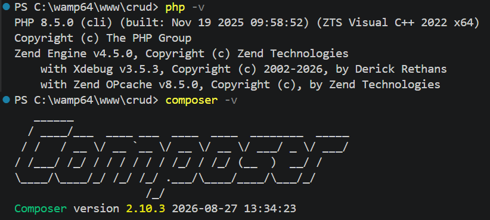

**Verificación de Node.js, npm y Laravel**

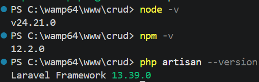

## 4. Estructura MVC

La organización del proyecto permite identificar los elementos que participan en el funcionamiento de la aplicación:

| Elemento | Archivo o carpeta | Función |
| --- | --- | --- |
| Modelo | `app/Models/Product.php` | Representa los productos y sus atributos |
| Controlador | `app/Http/Controllers/ProductController.php` | Procesa las operaciones CRUD |
| Solicitud de validación | `app/Http/Requests/ProductRequest.php` | Verifica los datos y autoriza la solicitud |
| Vistas | `resources/views/product/` | Contiene formularios, listado y consulta de productos |
| Rutas | `routes/web.php` | Define las direcciones y métodos HTTP |
| Migración | `database/migrations/*_create_products_table.php` | Define la tabla `products` |
| Configuración frontend | `vite.config.js` | Declara los recursos compilados por Vite |

La carpeta de vistas del generador está en **`resources/views/product/`** (singular), mientras que la ruta web es **`/products`** (plural). Esto coincide con el código real del proyecto.

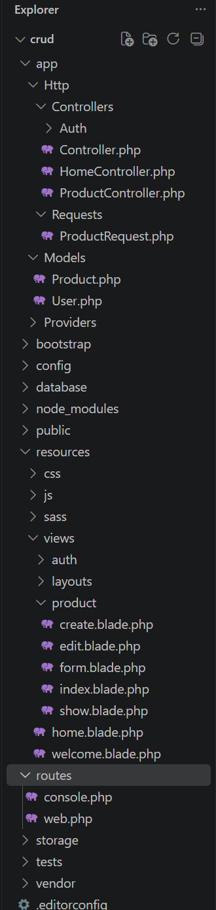

## 5. Desarrollo del laboratorio

### 5.1. Creación del proyecto

Se creó un proyecto nuevo en la carpeta `C:\wamp64\www\crud`, separado de los laboratorios anteriores. Los comandos principales fueron:

```powershell
cd C:\wamp64\www
laravel new crud
cd crud
code .
```

### 5.2. Configuración de la base de datos

En phpMyAdmin se creó una base de datos denominada **`crud`**. Después se configuró el archivo `.env` para establecer la conexión con MySQL:

```dotenv
APP_NAME=crud
APP_ENV=local
APP_DEBUG=true
APP_URL=http://localhost:8000

DB_CONNECTION=mysql
DB_HOST=127.0.0.1
DB_PORT=3306
DB_DATABASE=crud
DB_USERNAME=root
DB_PASSWORD=
```

El valor vacío de `DB_PASSWORD` corresponde al entorno local utilizado durante esta práctica; puede variar en otra instalación. Se omitió `APP_KEY` de las evidencias por motivos de seguridad. **El archivo `.env` real no se publica en este repositorio.**

**Configuración general:**

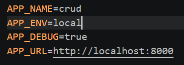

**Conexión MySQL:**

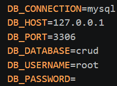

### 5.3. Migraciones y tabla de productos

Se ejecutaron comandos de configuración y migración; para generar el modelo y la migración de productos se utilizó:

```powershell
php artisan config:clear
php artisan migrate
php artisan make:model Product -m
# Se editaron los campos de la migración
php artisan migrate
php artisan migrate:status
```

La migración `create_products_table` define los campos:

```php
Schema::create('products', function (Blueprint $table) {
    $table->id();
    $table->string('description');
    $table->decimal('price', 8, 2);
    $table->integer('stock');
    $table->timestamps();
});
```

Se utilizó `decimal(8, 2)` para almacenar el precio con dos decimales. El campo `stock` almacena la cantidad disponible de cada producto.

**Migraciones ejecutadas:**

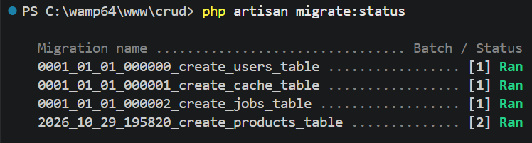

**Tabla de productos en MySQL:**

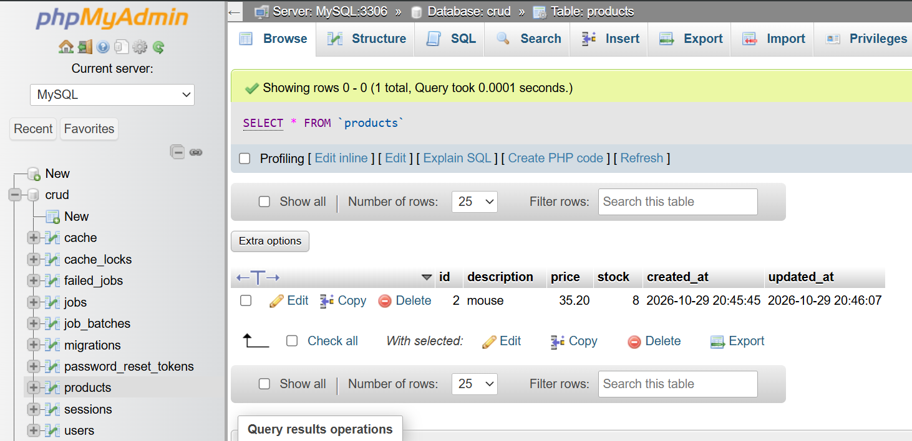

### 5.4. Autenticación, Bootstrap y generador CRUD

Se utilizó **Laravel UI** para crear las páginas de autenticación y los recursos Bootstrap, y **Ibex CRUD Generator** para generar el controlador y las vistas de productos. Los comandos principales fueron:

```powershell
composer require laravel/ui
php artisan ui bootstrap --auth
npm install
composer require ibex/crud-generator --dev
php artisan vendor:publish --tag=crud
php artisan make:crud products bootstrap
```

El generador detectó que el modelo `Product` ya existía, por lo que se conservó el modelo previo en lugar de sobrescribirlo. Además, se creó la clase `ProductRequest` para validar los formularios:

```powershell
php artisan make:request ProductRequest
```

Para corregir los recursos de Bootstrap y Tailwind se revisaron `resources/js/app.js`, `resources/js/bootstrap.js` y `vite.config.js`, manteniendo las siguientes entradas en Vite:

```javascript
input: [
    'resources/css/app.css',
    'resources/sass/app.scss',
    'resources/js/app.js',
],
```

También se instaló Axios, importado por el JavaScript del proyecto, y se compiló el frontend:

```powershell
npm install axios
npm run build
```

**Compilación satisfactoria:**

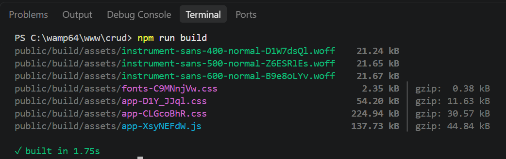

### 5.5. Rutas del CRUD y autenticación

En `routes/web.php` se registraron las rutas de productos y se protegieron con el middleware `auth`:

```php
Route::resource('products', ProductController::class)
    ->middleware('auth');

Route::redirect('/dashboard', '/home')
    ->middleware('auth');
```

El primer comando define siete rutas REST para los productos, mientras que el segundo permite que el enlace Dashboard redirija a la página `/home`. El proyecto utiliza **`/home`** como página del usuario autenticado.

**Verificación de rutas:**

```powershell
php artisan route:list --path=products -v
```

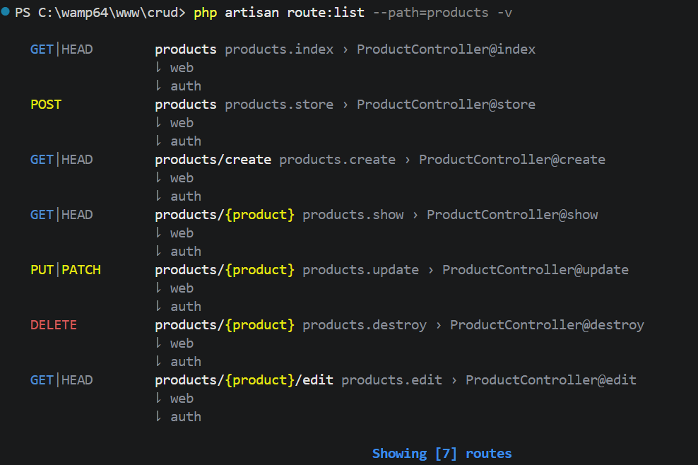

**Dashboard con acceso a productos:**

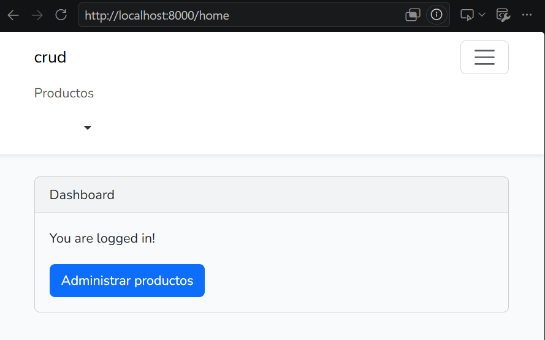

## 6. Operaciones CRUD y evidencias

Las operaciones se probaron desde `http://localhost:8000/products` utilizando productos ficticios. Los datos fueron comprobados tanto en la interfaz de Laravel como en phpMyAdmin.

### 6.1. Read: consultar productos

La página principal del CRUD muestra los productos registrados y dispone de las opciones **Show**, **Edit** y **Delete**.

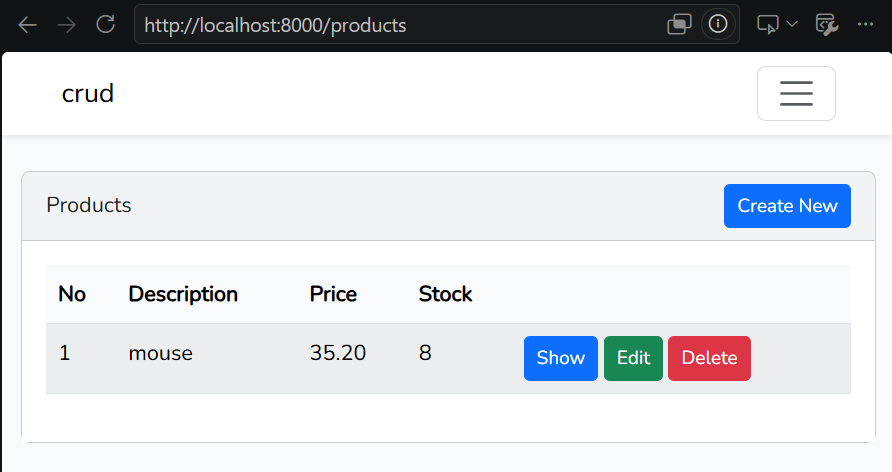

### 6.2. Create: registrar un producto

Para comprobar la creación se ingresó un producto con descripción `tv 10"`, precio `300` y stock `15`.

**Formulario antes de guardar:**

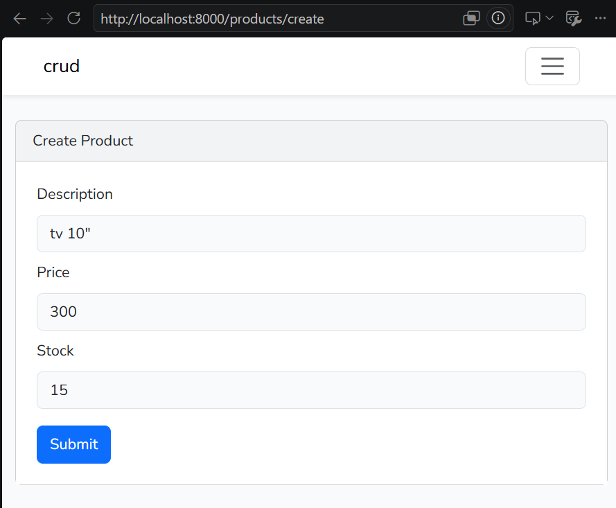

**Resultado después de guardar:**

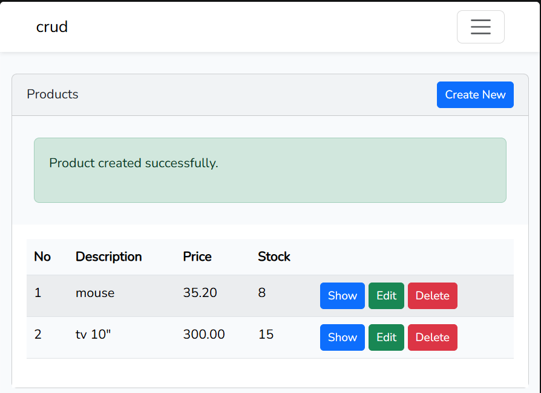

La aplicación mostró el mensaje `Product created successfully.` y el nuevo producto apareció en el listado.

### 6.3. Update: modificar un producto

Se seleccionó la opción **Edit** y se modificaron el precio de `300.00` a `150.00` y el stock de `15` a `10`.

**Formulario de edición:**

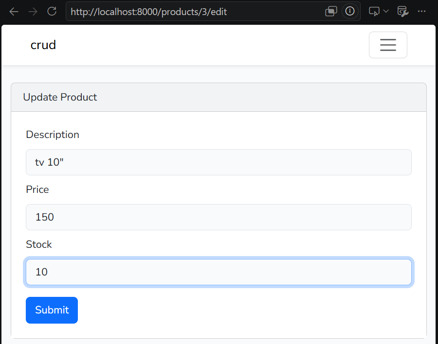

**Resultado de la actualización:**

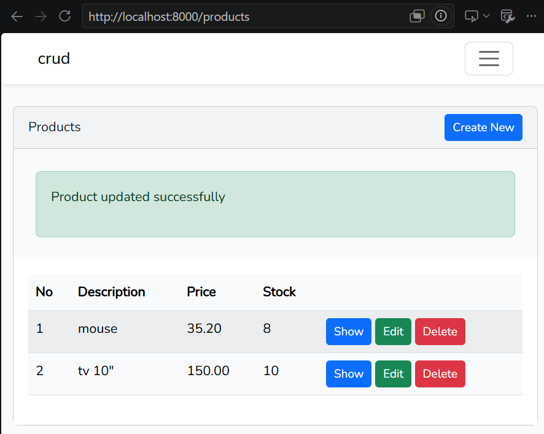

**Verificación de los cambios en phpMyAdmin:**

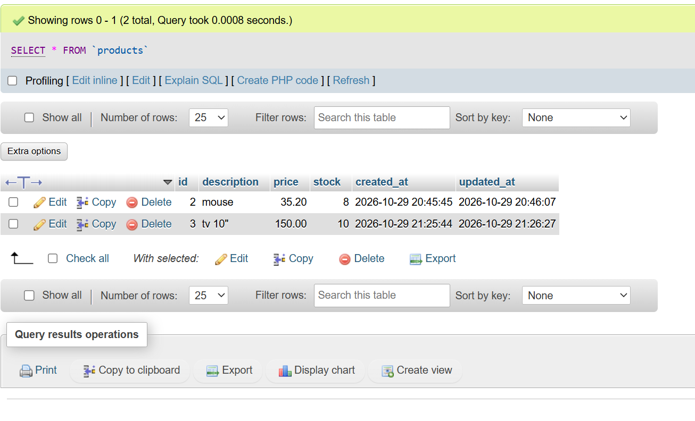

### 6.4. Delete: eliminar un producto

Para comprobar la eliminación se presionó el botón **Delete**. La aplicación mostró un cuadro de confirmación antes de completar la operación.

**Confirmación de eliminación:**

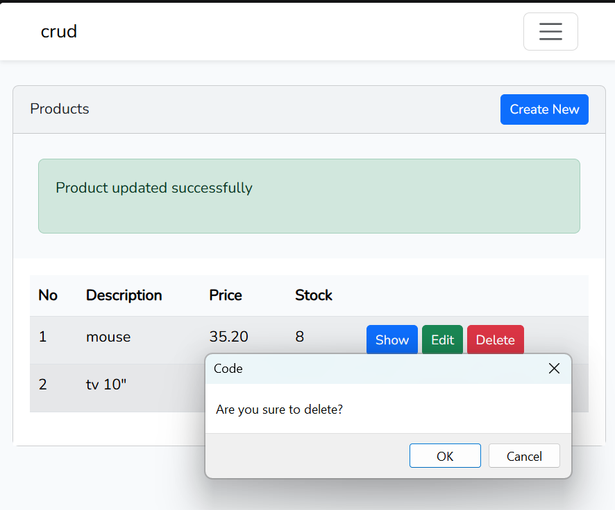

**Mensaje después de eliminar:**

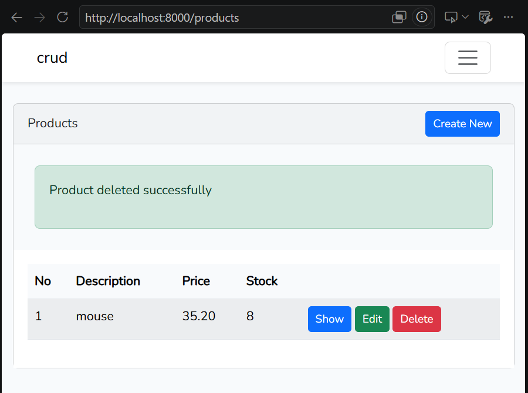

**Consulta posterior en phpMyAdmin:**

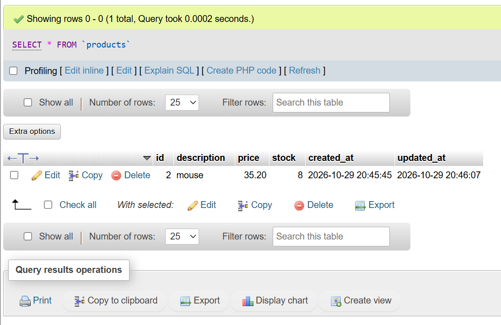

Se comprobó que el producto eliminado dejó de aparecer en el listado y en la base de datos. El otro producto de prueba permaneció registrado.

## 7. Validaciones y asignación masiva

### 7.1. Validación de campos obligatorios y valores negativos

El archivo `ProductRequest.php` contiene reglas que exigen una descripción, un precio numérico no negativo y un stock entero no negativo:

```php
public function authorize(): bool
{
    return true;
}

public function rules(): array
{
    return [
        'description' => ['required', 'string', 'max:255'],
        'price' => ['required', 'numeric', 'min:0'],
        'stock' => ['required', 'integer', 'min:0'],
    ];
}
```

Se probaron formularios sin datos y con números negativos. En ambos casos la aplicación mostró errores de validación en lugar de guardar registros incorrectos.

**Campos obligatorios:**

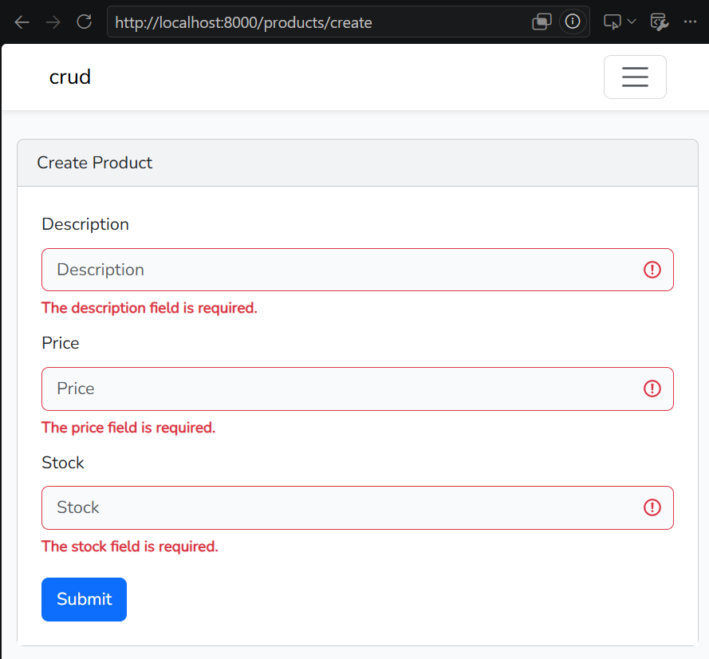

**Precio y stock negativos:**

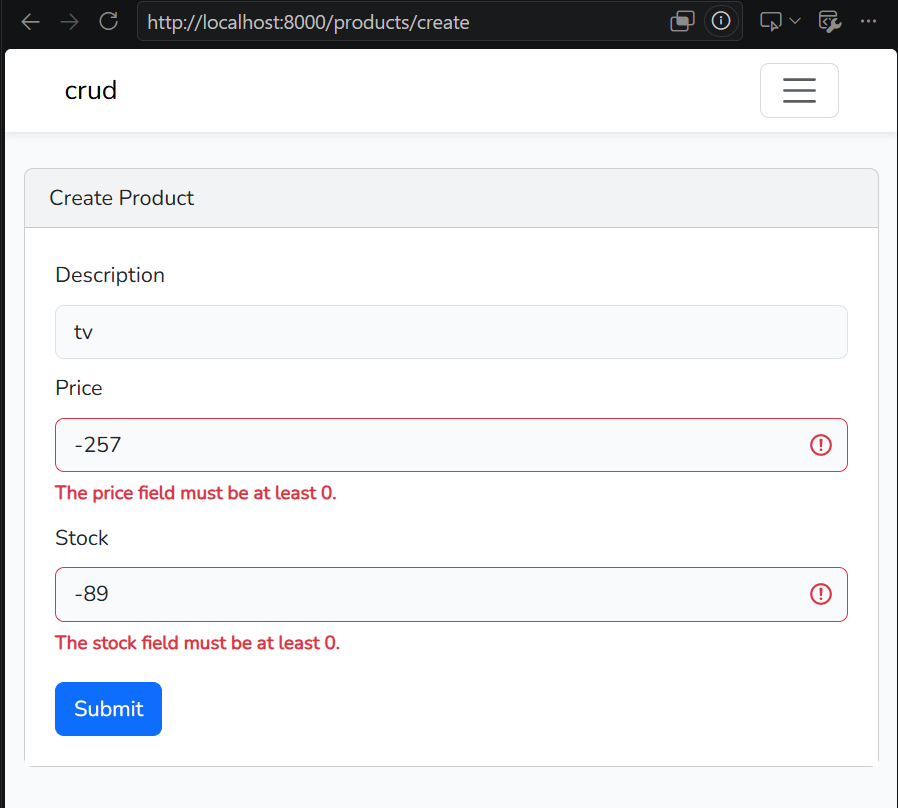

**Archivo de validación implementado:**

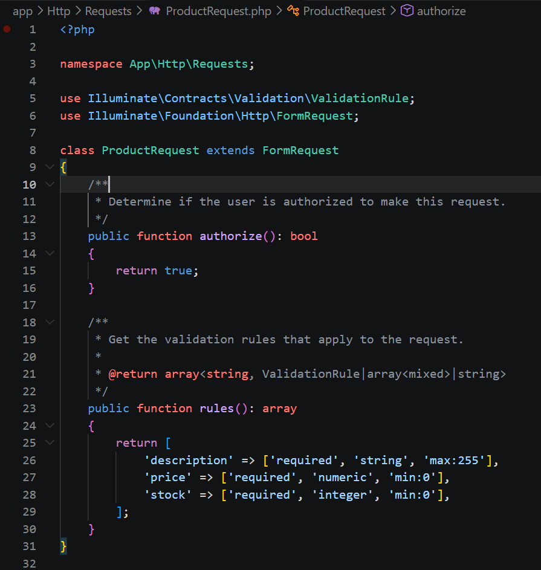

### 7.2. Uso de $fillable

En el modelo `Product`, el arreglo `$fillable` indica qué atributos se pueden asignar de forma masiva cuando se utilizan métodos de Eloquent, como `create()` y `update()`. Solo se habilitaron los campos que corresponden al producto:

```php
protected $fillable = [
    'description',
    'price',
    'stock',
];
```

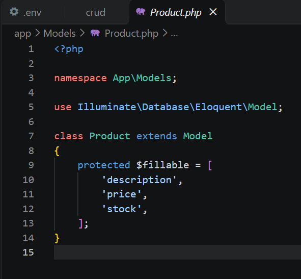

Esta configuración ayuda a evitar que se modifiquen otros atributos mediante asignación masiva no prevista.

## 8. Dificultades encontradas y soluciones

| Dificultad | Solución aplicada |
| --- | --- |
| Laravel intentó conectarse inicialmente a la base `laravel`, que no existía. | Se ajustó `DB_DATABASE=crud` en `.env` y se verificó la conexión con MySQL. |
| El generador detectó un modelo `Product` existente. | Se respondió **No** a la sobrescritura para conservar el modelo y su estructura. |
| No se mostraban las rutas de productos al consultar `route:list`. | Se agregó `Route::resource('products', ProductController::class)` en `routes/web.php`. |
| La página de bienvenida perdió los estilos al instalar Bootstrap. | Se revisó `vite.config.js` para compilar tanto Tailwind como Bootstrap. |
| Al guardar un producto apareció `ReflectionException` porque faltaba `ProductRequest`. | Se creó `ProductRequest.php` y se agregaron las reglas de validación. |
| El enlace Dashboard dirigía a `/dashboard` y mostraba error 404. | Se configuró el acceso a `/home` y se añadió una redirección desde `/dashboard`. |
| Se necesitaba escribir manualmente `/products` para entrar al CRUD. | Se añadió el enlace **Productos** a la barra y un botón **Administrar productos** en Home. |

Las advertencias de Sass vistas durante algunas compilaciones no impidieron la generación final de los recursos con `npm run build`.

## 9. Cómo ejecutar el proyecto desde el repositorio

Estos pasos son para **restaurar una copia del proyecto ya desarrollado**; no es necesario ejecutar nuevamente `make:model`, `make:crud` ni `ui bootstrap --auth`, porque los archivos generados ya están incluidos.

1. Copiar o clonar el repositorio en una carpeta local, por ejemplo `C:\wamp64\www\crud`.
2. Iniciar MySQL en WampServer y crear en phpMyAdmin una base de datos vacía llamada **`crud`**.
3. Abrir PowerShell o la terminal de VS Code **dentro de la carpeta del proyecto** y ejecutar:

   ```powershell
   composer install
   Copy-Item .env.example .env
   php artisan key:generate
   ```

4. Comprobar que `.env` tiene la conexión a la base de datos y las credenciales correctas. Luego ejecutar:

   ```powershell
   php artisan config:clear
   php artisan migrate
   npm install
   npm run build
   ```

5. Iniciar el sistema:

   ```powershell
   composer run dev
   ```

6. Abrir `http://localhost:8000`, registrar un usuario de prueba en `/register`, iniciar sesión y entrar a **Productos** desde el Dashboard o la barra de navegación. El recurso está disponible en `http://localhost:8000/products` después de autenticarse.

> **Nota de seguridad:** `.env` incluye configuraciones privadas y no debe subirse a GitHub. `.env.example` se entrega sin `APP_KEY` ni contraseñas. `APP_DEBUG=true` corresponde solamente al entorno local de desarrollo.

> **Base de datos:** el repositorio incluye las migraciones necesarias para reconstruir las tablas. No incluye una exportación real de MySQL ni registros de usuarios, para evitar publicar datos de sesión o información personal. Si la profesora solicita un archivo `.sql`, debe exportarse una copia depurada desde phpMyAdmin.

## 10. Verificaciones finales

Los comandos siguientes se ejecutan dentro de `C:\wamp64\www\crud`:

```powershell
php artisan --version
php artisan migrate:status
php artisan route:list --path=products -v
php artisan db:table products
composer show laravel/ui
composer show ibex/crud-generator
```

La aplicación se comprobó mediante el navegador y phpMyAdmin: se creó un producto, se consultaron sus valores, se actualizaron sus datos y finalmente se eliminó correctamente. También se verificaron las reglas de validación y las rutas con middleware `auth`.

## 11. Conclusión

Durante el desarrollo de este laboratorio pude aprender cómo implementar las operaciones CRUD en Laravel utilizando un generador que facilita la creación de varios de los archivos necesarios para administrar los registros de una base de datos. También pude comprender la relación que existe entre los modelos, las vistas, los controladores, las rutas y las migraciones, ya que cada uno cumple una función importante para que la aplicación pueda registrar, consultar, actualizar y eliminar productos correctamente.

Además, pude aprender sobre la importancia de validar los datos ingresados en los formularios y de utilizar `$fillable` para controlar los atributos que pueden modificarse en el modelo. A través de los problemas que aparecieron con la configuración de MySQL, los estilos de Bootstrap y la clase `ProductRequest`, pude comprender mejor cómo revisar los errores y corregirlos hasta lograr que el sistema funcionara correctamente.

## 12. Referencias

1. Laravel. (2026). *Documentación de Laravel 13.x*. https://laravel.com/framework/docs
2. Laravel. (2026). *Resource controllers*. https://laravel.com/docs/13.x/controllers#resource-controllers
3. Laravel. (2026). *Validation*. https://laravel.com/docs/13.x/validation
4. Laravel. (2026). *Database: Migrations*. https://laravel.com/docs/13.x/migrations
5. Laravel. (2026). *Eloquent ORM*. https://laravel.com/docs/13.x/eloquent
6. Ibex. (s. f.). *Laravel CRUD Generator*. https://github.com/ibex/crud-generator
7. Fong, I. (2026). *Acercamiento a un CRUD rápido en Laravel: Guía del laboratorio #2* [Presentación de clase]. Universidad Tecnológica de Panamá.

## 13. Información académica

- **Nombre:** Andres Dommar
- **Curso:** Desarrollo Web
- **Docente:** Ing. Irina Fong
- **Fecha de ejecución:** 22 de octubre del 2026
- **Fecha de entrega:** 23 de octubre del 2026
